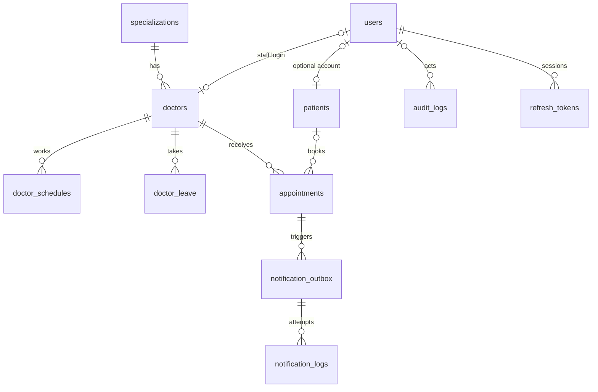

# Database design

PostgreSQL (Neon) is the single source of truth. Schema is managed only by Alembic
(`backend/app/database/migrations`). All primary keys are UUIDs; timestamps are `timestamptz` (UTC).

Also standalone: `otp_challenges` (keyed by phone hash), `clinic_settings` (booking policy), `chatbot_feedback` (table exists, no endpoint yet).

## Double-booking protection
1. `ex_appointments_no_overlap`: `EXCLUDE USING gist (doctor_id WITH =, tstzrange(start_at,end_at,'[)') WITH &&)`
   for PENDING/CONFIRMED, non-deleted rows (extension `btree_gist`). Back-to-back slots are allowed;
   cancelled/rescheduled rows free the slot.
2. The booking service must first `SELECT ... FOR UPDATE` the doctor row. Tested finding: without it,
   racing inserts still never double-book, but losers can be aborted with `deadlock_detected`
   instead of a clean exclusion violation. The service must also map deadlock/serialization errors
   to "slot unavailable".
3. Unique `appointment_reference` and `idempotency_key`.

## PII
Phone/email are stored encrypted (`*_encrypted`, Fernet key from env) with an HMAC
`*_hash` for lookups. `notification_outbox.payload` holds minimal data only. `chatbot_feedback`
stores a rating, never conversation text.

## Other decisions
- Enums are constrained strings (CHECK) instead of native PG enums: easier migrations.
- Soft delete (`deleted_at`) on users, patients, doctors, appointments; partial unique indexes ignore deleted rows.
- `weekday`: Monday=0 .. Sunday=6. `is_demo` marks seeded demo data.
- Seed: `python -m app.database.seed` (idempotent). No credentials or real contact data are seeded.
- Migrations use `MIGRATION_DATABASE_URL` > `DATABASE_URL_UNPOOLED` > `DATABASE_URL`; the app uses the pooled URL.

## otp_challenges (migration 0002)
`id`, `phone_hash` (HMAC, same as patients), `code_hash` (HMAC bound to id + phone hash), `expires_at`, `attempts`, `consumed_at`, `created_at`; index `(phone_hash, created_at)`. No raw code or phone number is stored.

## refresh_tokens (migration 0003)
`id`, `user_id` (FK, cascade), `family_id`, `token_hash` (SHA-256, unique), `expires_at`, `revoked_at`, `created_at`. One family per login; rotation revokes the used token, and presenting a revoked one revokes the whole family.

## Retention (run by `/internal/cron/notifications`, `services/retention.py`)
| Data | Kept |
| --- | --- |
| `otp_challenges` | 1 day after creation |
| `refresh_tokens` | 7 days after expiry, 30 days after revocation |
| `notification_outbox` (SENT / SKIPPED / DEAD) and its `notification_logs` | 90 days |
| `audit_logs`, `appointments`, `patients` | not purged automatically; the clinic must define a policy (no erasure tooling exists yet) |

## Migrations
`0001` initial schema, `0002` OTP, `0003` refresh tokens. CI checks that the models match the migrations (`alembic check`) and that all of them reverse on an empty database. Production (Neon) was last seen at `0001`; the Deploy workflow applies the rest.
